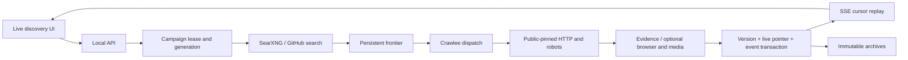
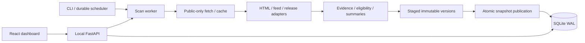
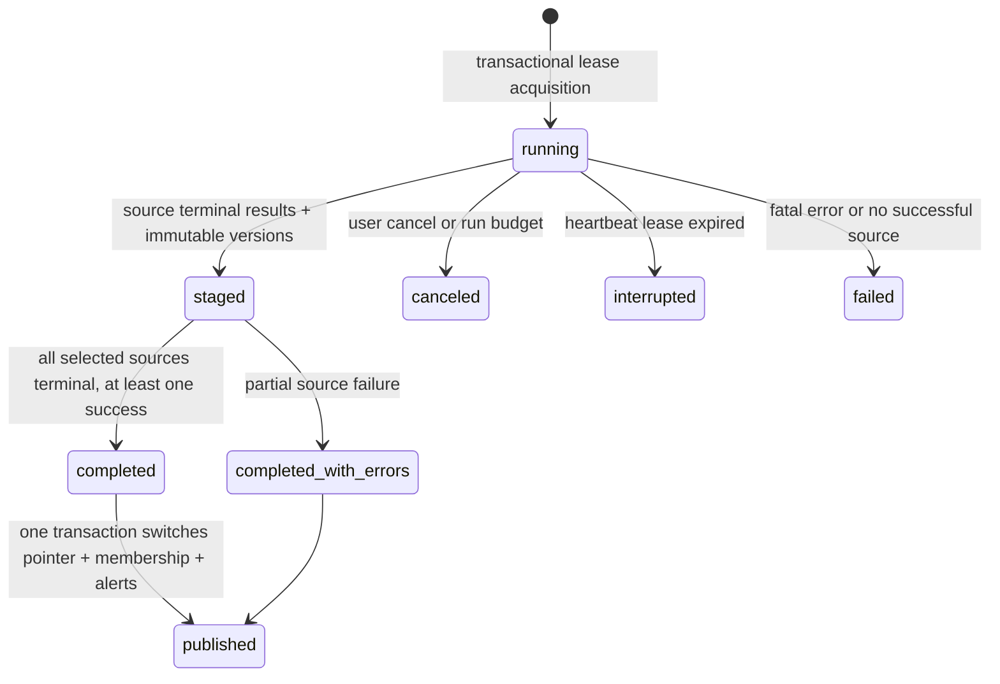

# Architecture

## Dynamic pipeline (current primary workflow)

The dynamic master prompt supersedes batch-only publication. SQLite now holds a
persistent frontier, campaign/task leases and generations, queries/hits, issuer
observations, media jobs, repository observations, live membership and ordered events.
Migrations 004–005 preserve all prior archives and user state.

- `discovery_store.py` owns transactions, cross-mode locks, task leases, generation
  fencing, immediate publication and completion archives. Failed fetches preserve
  the prior version and mark its live pointer stale. Provisional rediscovery never
  downgrades an evidence version. Canceled/failed campaigns retain committed results.
- `discovery_search.py` rotates English/Tamil/transliterated queries, prefers Chennai/
  India while exploring globally, calls only the fixed local SearXNG endpoint, and
  records upstream-engine diagnostics. GitHub licenses are API declarations; growth
  needs two observations at least one hour apart. No discovered code is executed.
- `discovery.py` allocates novel/revisit work, limits page/query/domain/depth/bytes/
  queue/time/disk budgets, discovers relevant links/feeds/sitemaps and emits actual
  stages. SQLite is authoritative; Crawlee queues are temporary per-batch dispatch.
  Session rotation, blocked-response retries, stealth and proxy evasion are disabled.
- `discovery_identity.py` requires reciprocal cross-domain URLs plus matching public
  name, phone and locality. Name similarity alone never establishes issuer support.
  A supported post is labeled issuer-posted with redemption unconfirmed; identity
  locality does not establish a particular offer's branch or geographic eligibility.
- `discovery_browser.py` fulfills every HTTP subrequest through the pinned fetcher.
  Isolated contexts have no personal cookies. Websockets/workers/media are blocked;
  a closed local proxy blocks unhandled direct-network fallback. Challenges stop work.
- `discovery_media.py` handles permitted direct files up to 2 MB, timestamped captions
  and optional local Tesseract/faster-whisper. Extraction uses a timeout-bounded process,
  temporary files and local-only ffmpeg protocols. No automatic model download.
- `discovery_alerts.py` evaluates local rules transactionally with publication, with
  provisional opt-in, filters, cooldowns, correction and deferred IST quiet-hour delivery.
- `discovery_api.py` provides controls, history/SSE, frontier/coverage/capabilities and
  alert rules. Last-Event-ID resumes persisted events; keepalives are not activity.
- `current_membership` overlays live pointers on the latest legacy archive. Results,
  exports, detail, tracker and digest use it unless a historical snapshot is selected.
  Snapshots remain immutable. Detail history never exposes legacy staged versions.
- `frontend/src/Discovery.tsx` shows actual events, replay state, controls, queue,
  observed coverage, media gaps and rules. Cards expose provisional/evidence status;
  Near Chennai requires source-declared coordinates and excludes unknown locations.

High memory use reduces dispatch to one task and defers browser/media; extreme
pressure or disk/network budgets stop additional batches. A bounded in-flight batch
may finish. Existing user scheduling remains disarmed/preserved; new settings default
to continuous discovery. CLI/API/scheduler share cross-process acquisition.

## Retained legacy source-scan workflow

The remaining scan-specific description below applies to explicit seed tests and
legacy CLI scans. Dynamic discovery publishes per item as described above.

Implemented modular monolith: native FastAPI plus one in-process asynchronous scan
worker/scheduler, with SQLite coordinating CLI and additional processes.

Published membership and opportunity versions are immutable. Stable user item
state is independent. A database lease and heartbeat arbitrate scans across
processes; source failures are terminal diagnostics, not fatal run exceptions.
Baseline summarization is deterministic; optional model output is constrained.

## Component map and boundaries

- `backend/models.py`: strict Pydantic request/source/settings/filter schemas.
  `sources/registry.yaml` seeds new IDs only; explicit import updates existing IDs.
- `backend/db.py` and numbered SQL migrations: WAL, foreign keys, busy timeout,
  indexes and optional FTS5. One connection/transaction per operation, no ORM.
  Source/scan diagnostics, settings and immutable opportunity fields use validated
  JSON; identities, versions, evidence, membership and user state are separate tables.
- `backend/fetch.py`: connection-pinned public DNS, original-host TLS verification,
  per-host lock/spacing, robots, retry/deadline/size budgets, conditional cache and
  per-run circuit breaker. The model client is a separate fixed-loopback integration.
- `backend/extract.py`: RSS/Atom, HTML, structured events, GitHub release and optional
  public-search adapters; canonical identity, explicit official domain checks,
  excerpts/conditions/geography/date precision and template summaries. Page content
  is data. No scripts or model instructions execute from it.
- `backend/summary.py`: disabled-by-default Ollama extractive selection, strict
  output validation, one bounded request at a time, template fallback/cache.
- `backend/scanner.py`: immutable run roster/settings snapshot, unique active-run
  index, 90-second lease, one-second heartbeat, bounded task semaphore, staged
  candidates/version reuse and transactional membership/pointer/alert publication.
- `backend/scheduler.py`: durable next-run and worker heartbeat, Asia/Kolkata daily
  time, coalesced catch-up and per-source due selection. No OS schedule is installed.
- `backend/query.py`: one SQL predicate builder for paginated results and all-row
  exports; FTS5 or LIKE fallback; exact filters exclude unknown values. Historical
  lifecycle is evaluated at snapshot publication, current results at query time.
- `backend/planning.py`: publication-only digest and Markdown export, independent
  personal application state in migration 003, IST reminder alerts, and RFC 5545
  calendar export. Personal dates never populate official deadline fields. Digest
  changes compare published memberships and do not depend on alert settings.
- `backend/api.py`: local Host/Origin/token boundary, query/state/source/schedule/
  alert APIs and production static assets. `__main__.py` supplies CLI scan and
  native operation, consistent backup and safe new-directory restore.
- `frontend/src`: React navigation, controlled filter/saved/URL state, polling for
  status only, evidence dialog, source review, personal state and settings forms.
  React escapes text and evidence URLs are restricted to credential-free HTTP(S).
  `frontend/src/Planning.tsx` supplies Tracker, Digest and the detail tracking editor.
  API requests have a 20-second timeout, canceled searches cannot overwrite newer
  results, and status polling never queues overlapping requests. Dialog feedback
  is rendered inside the active dialog. Scheduler database work and HTML parsing
  run off the API event loop to keep controls responsive.

## Publication and recovery

Each snapshot owns immutable membership. Bookmarks/notes/dismissals use stable URL
identity. Material fingerprints exclude observation timestamps and model status;
unchanged sightings do not duplicate versions/alerts. Prior items missing from a
selected source carry forward as stale; unselected-source observations retain their
previous stale status. Failure never implies withdrawal. A retry starts a new run
with cached fetches and stable IDs, rather than reopening historical membership.

Raw cached bodies have configurable manual retention; immutable historical evidence
is retained. Source-specific natural-language extraction remains conservative.
Close semantic matches are left separate rather than risking regional/tier merges.
OS tasks, external notifications and large model downloads are not part of startup.
